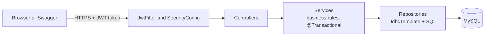
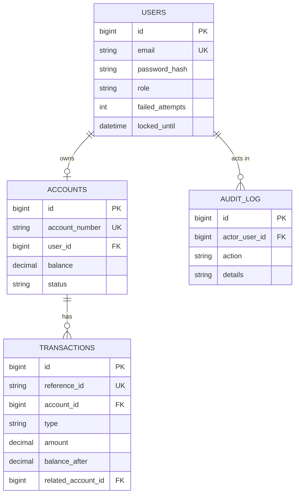

# SecureBank: a banking backend built with Spring Boot

[](https://github.com/deepanshu-chaurasia29/YOUR_REPO/actions)


A secure, well-tested banking REST API with a small web front end. Customers can register, deposit, withdraw,
transfer money, and see their history. Admins can search accounts, freeze them, and unlock users.
The focus is **correctness under concurrency**: money must stay right even when many requests arrive at the same moment.

> **Demo project.** All money is demo money. Please do not enter real personal data.

**Live demo:** `https://YOUR-APP.onrender.com` &nbsp;|&nbsp; **API docs (Swagger):** `https://YOUR-APP.onrender.com/swagger-ui.html`
*(Free hosting: the first request after 15 minutes of silence can take about a minute while the server wakes up.)*

<!-- Add 3 or 4 screenshots in docs/screenshots/ and show them here, for example:


-->

---

## Features

**Customer**
- Register (an account with a unique 12-digit number is created) and log in with a JWT token
- Deposit, withdraw, and transfer to another account number
- Transaction history: newest first, filters (type, dates), paging
- Change password (wrong old passwords are counted and can lock the user)

**Admin** (role `ADMIN`)
- Search accounts by name, email or account number, with paging
- Freeze and unfreeze accounts (a frozen account cannot send or receive money)
- See the history of any account, and unlock users who were locked after wrong passwords
- Every admin action is written to an **audit log**

**Security**
- BCrypt password hashing, stateless JWT login (30 minutes), role-based access
- A customer can only reach their own data (the user id always comes from the token, never from the URL)
- Lockout after 3 wrong passwords (15 minutes), also for the change-password endpoint
- One standard JSON format for every error, no stack traces
- No secrets in the code: everything comes from environment variables

---

## Engineering highlights

| Problem | Solution | Proof |
|---|---|---|
| **Double spending** when two requests change the same balance | Row lock with `SELECT ... FOR UPDATE` inside `@Transactional` | `TransferConcurrencyTest`: 50 parallel transfers, exactly the right number succeed |
| **Deadlock** when A sends to B while B sends to A | Always lock the **lower account id first** | `oppositeTransfers...doNotDeadlock` test |
| **Wrong daily limit** because of an old data snapshot | `READ_COMMITTED` isolation for transfers | `parallelTransfers_cannotBreakTheDailyLimit` test |
| **Lockout silently undone** (Spring rolls back on exceptions) | `@Transactional(noRollbackFor = ApiException.class)` | `AuthLockoutIntegrationTest` reads the counter back from MySQL |
| **Parallel wrong passwords** beating the lockout | Lock the user row while logging in | `AuthParallelLoginIntegrationTest`: 20 parallel attempts, lock after exactly 3 |
| **Rounding errors with money** | `DECIMAL(15,2)` in MySQL and `BigDecimal` in Java, never `double` | Unit tests with exact amounts |
| **SQL injection / XSS** | Only `?` parameters in SQL, only `textContent` in the browser | By design |
| **Leaked secrets** | Environment variables, no default admin password, the app refuses to start in Docker with the default JWT secret | `StartupChecksTest` |

---

## Tech stack

| Area | Technology |
|---|---|
| Language | Java 21 |
| Framework | Spring Boot 3.3 (Web, Security, Validation, JDBC) |
| Database access | Spring `JdbcTemplate` (plain SQL) |
| Database | MySQL 8 |
| Security | Spring Security, JWT (jjwt), BCrypt |
| API docs | springdoc OpenAPI (Swagger UI) |
| Health check | Spring Boot Actuator |
| Tests | JUnit 5, Mockito, MockMvc, real-database integration tests |
| Build / CI | Maven, GitHub Actions |
| Packaging | Docker (multi-stage build), Docker Compose |
| Hosting | Render (app) + Aiven (MySQL) |
| Front end | Plain HTML, CSS, JavaScript (served by Spring Boot) |

---

## Architecture



Each layer has one job: **Controller** (HTTP in and out), **Service** (rules and transactions), **Repository** (SQL).

## Data model



---

## API overview

Full interactive docs: `/swagger-ui.html` (use **Authorize** and paste your token).

| Method | URL | Who | Purpose |
|---|---|---|---|
| POST | `/api/v1/auth/register` | public | Register and create an account |
| POST | `/api/v1/auth/login` | public | Log in, get a JWT |
| POST | `/api/v1/auth/change-password` | logged in | Change own password |
| GET | `/api/v1/accounts/me` | customer | Own account and balance |
| POST | `/api/v1/transactions/deposit` | customer | Deposit |
| POST | `/api/v1/transactions/withdraw` | customer | Withdraw |
| POST | `/api/v1/transactions/transfer` | customer | Transfer to another account |
| GET | `/api/v1/transactions/me` | customer | History (filters and paging) |
| GET | `/api/v1/admin/accounts` | admin | Search accounts |
| PUT | `/api/v1/admin/accounts/{id}/freeze` and `/unfreeze` | admin | Freeze or unfreeze |
| GET | `/api/v1/admin/accounts/{id}/transactions` | admin | History of any account |
| PUT | `/api/v1/admin/users/{id}/unlock` | admin | Unlock a user |
| GET | `/actuator/health` | public | Health check |

---

## Run it locally

You need Java 21 (or newer), Maven, and MySQL 8.

1. Clone the repo and open it in IntelliJ.
2. Set these **environment variables** in your run configuration (never write them into files):

   | Name | Example |
   |---|---|
   | `DB_PASSWORD` | your MySQL password |
   | `ADMIN_EMAIL` | `admin@securebank.com` (creates the first admin) |
   | `ADMIN_PASSWORD` | 8+ characters with a letter and a number |
   | `JWT_SECRET` | optional locally, **required** when deployed (32+ random characters) |

3. Run `SecurebankApplication`. The tables are created automatically. Open <http://localhost:8080>.
4. Log in with the admin email and password to see the admin panel, or register a customer.

### With Docker

```
cp .env.example .env        # then edit .env and fill in real values
docker compose up --build
```
The app is then on <http://localhost:8080> (MySQL runs in its own container).

## Tests

```
mvn test
```
- **57 automated tests**: unit tests (Mockito, no database) and integration tests (real MySQL).
- The integration tests use a separate database, `securebank_test`. They refuse to run on any other database.
- They need MySQL running and the `DB_PASSWORD` environment variable.
- GitHub Actions runs everything on every push, using a MySQL service container.

## Deployment

The app runs in a Docker container on Render, with a managed MySQL on Aiven. Step by step guide:
[docs/DEPLOYMENT_GUIDE.md](docs/DEPLOYMENT_GUIDE.md).

## Project structure

```
src/main/java/com/deepu/securebank/
  config/       OpenAPI settings, business limits, admin seeder, startup checks
  controller/   REST endpoints (thin)
  dto/          request and response objects
  exception/    one standard error format
  model/        plain data classes
  repository/   JdbcTemplate + SQL
  security/     JWT, filter, access rules
  service/      business rules and transactions
  util/         account number masking
src/main/resources/
  schema.sql    the four tables
  static/       the web pages (login, dashboard, admin)
src/test/java/  unit tests and integration tests
docs/           deployment guide, demo script, resume and interview notes
```

## Known limitations and ideas for version 2

- Old JWT tokens stay valid until they expire (30 minutes), even after a password change
- No idempotency key yet (the same transfer request sent twice is processed twice)
- Forgot password with an email OTP, CSV statements, and admin statistics are not built
- No rate limiting for the whole API (only the login lockout)

## Author

**Deepanshu Chaurasia**, B.Tech Computer Science student (AKTU), aspiring Java developer.
[GitHub](https://github.com/deepanshu-chaurasia29) | [LinkedIn](https://www.linkedin.com/in/YOUR-LINKEDIN)
